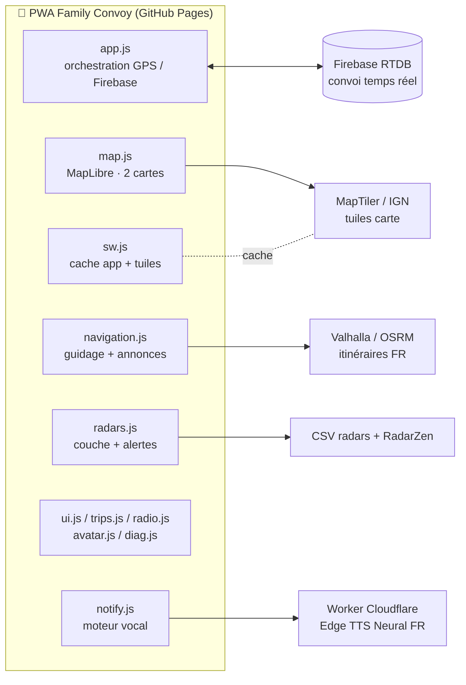

# 🚗 Family Convoy

**Le convoi familial connecté, gratuit et sans quota.**
Positions en temps réel, navigation GPS vocale en français, alertes radars, mode conduite plein écran — le tout en PWA installable, sans carte bancaire ni abonnement.

🌐 **Démo / app :** https://mikefri-studio.github.io/FamilyConvoy/

---

## ✨ Fonctionnalités

### 👨‍👩‍👧‍ Convoi en temps réel
- Positions live de chaque véhicule (Firebase Realtime DB)
- Rôles automatiques **GPS** / **écran** (un seul téléphone émet, les autres affichent)
- Appairage d'un second appareil par **QR code**
- **Radio push-to-talk** (maintiens pour parler) entre membres
- Alertes intelligentes : véhicule arrêté, batterie faible, éloignement, perte de signal
- Logo / emoji / couleur personnalisables par membre + emblème de groupe

### 🧭 Mode solo
- Toute l'app fonctionne **sans convoi** : navigation, radars, voix, trajets
- Aucun partage de position, tout reste local

### 🗺️ Navigation GPS
- Moteur **Valhalla** (instructions en français natif) + secours **OSRM**
- Options : plus rapide / plus court / éviter autoroutes / éviter péages
- Tracé bleu sur la carte principale **et** la carte conduite
- Recalcul automatique en cas de déviation
- Bandeau enrichi : manœuvre, « puis… », distance, ETA, heure d'arrivée, barre de progression
- Annonces vocales adaptatives à la vitesse (1 anticipée + 1 immédiate, jamais de répétition)

### 🎤 Voix françaises de qualité studio
- **13 voix Microsoft Neural FR** (🇫🇷 🇨🇦 🇧🇪 🇨🇭) via un worker Cloudflare personnel
- Cache audio local 7 jours, file d'attente, anti-répétition
- Repli automatique sur les voix système (offline) si le worker est indisponible

### 📷 Radars & signalements
- Radars fixes + mobiles (base CSV open data) + **RadarZen** + signalements communautaires
- Alertes vocales / visuelles / bip, rayon et distance d'alerte réglables
- Affichage sur les deux cartes, popup détail (VMA, type, date)

### 🏎️ Mode conduite
- Activation **automatique** dès 30 km/h, sortie à l'arrêt
- Carte 3D inclinée, option **cap vers le haut**
- **Compteur de vitesse** anneau lumineux + grand digital (sans aiguille)
- Boutons au pouce en bas à droite, carte de guidage collée en haut à gauche en **paysage**
- Écran maintenu allumé (Wake Lock)

### 📊 Trajets & replay
- Enregistrement automatique des trajets (convoi ou solo)
- Historique + **replay animé** du parcours

### 📱 PWA
- Installable iOS / Android avec vraie icône
- Service worker : cache de l'app + **cache des tuiles carte** (zones blanches partiellement couvertes)
- Mise à jour automatique

---

## 🏗️ Architecture



| Brique | Service | Coût |
|---|---|---|
| Temps réel | Firebase Spark | 0 € |
| Cartes | MapTiler free + IGN Géoplateforme | 0 € |
| Routage | Valhalla public + OSRM secours | 0 € |
| Voix | Cloudflare Workers free (Edge TTS) | 0 € |
| Radars | CSV open data + RadarZen | 0 € |
| Hébergement | GitHub Pages | 0 € |

---

## 📂 Structure

```
FamilyConvoy/
├── index.html              # interface (convoi · solo · conduite)
├── manifest.webmanifest    # PWA + icônes PNG
├── sw.js                   # cache app + tuiles carte
├── icon.svg
├── icons/                  # PNG générés (192 / 512 / maskable / 180)
├── css/style.css           # feuille unique responsive + paysage
├── js/                     # 15 modules ES découplés
└── tools/generate-icons.html  # générateur d'icônes PNG
```

---

## 🚀 Déploiement

1. Fork / clone ce dépôt, active **GitHub Pages** (branche `main`, racine).
2. Renseigne tes clés dans `js/config.js` (MapTiler, Firebase).
3. Déploie le worker TTS (`cloudflare-edge-tts`) et colle son URL dans `js/notify.js`.
4. Génère les icônes : ouvre `tools/generate-icons.html`, télécharge les 4 PNG dans `icons/`, commit.
5. C'est en ligne. 🎉

---

## 📸 Captures

| Convoi | Solo | Conduite | Paysage |
|---|---|---|---|
|  |  |  |  |

> Ajoute tes captures dans `docs/screenshots/` avec ces noms exacts.

---

## 🔒 Confidentialité

- En **solo**, aucune donnée ne quitte l'appareil (trajets en localStorage).
- En **convoi**, seules position / pseudo / batterie sont partagées avec le groupe choisi.
- Aucune analytics, aucun traceur, aucune publicité.

## 📄 Licence

MIT — fais-en bon usage, prudemment, et les yeux sur la route. 🚗
